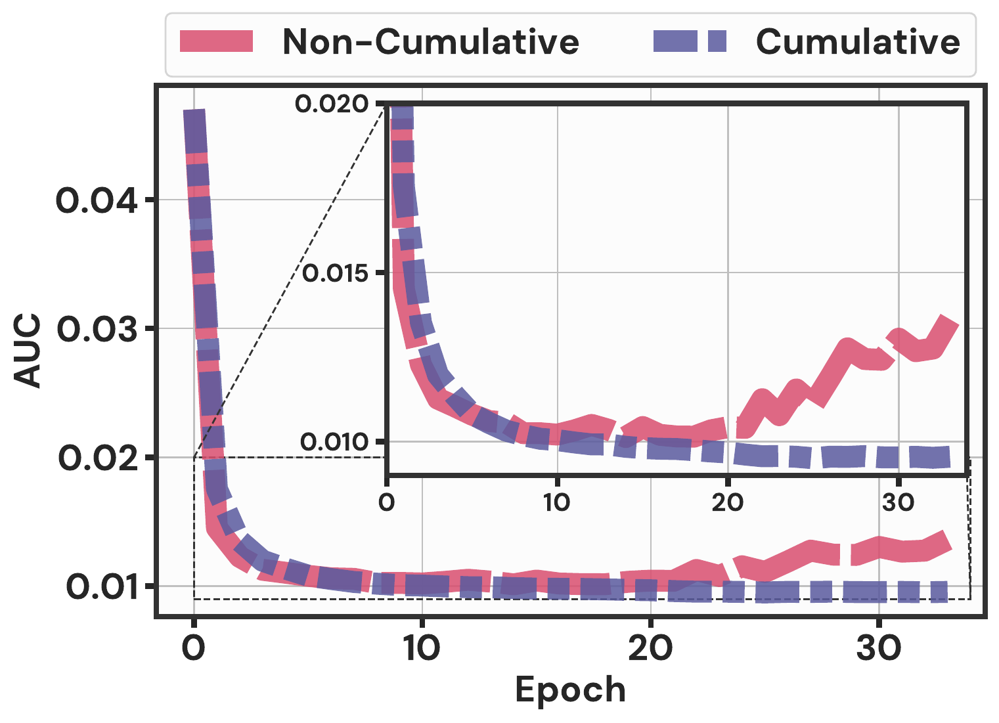
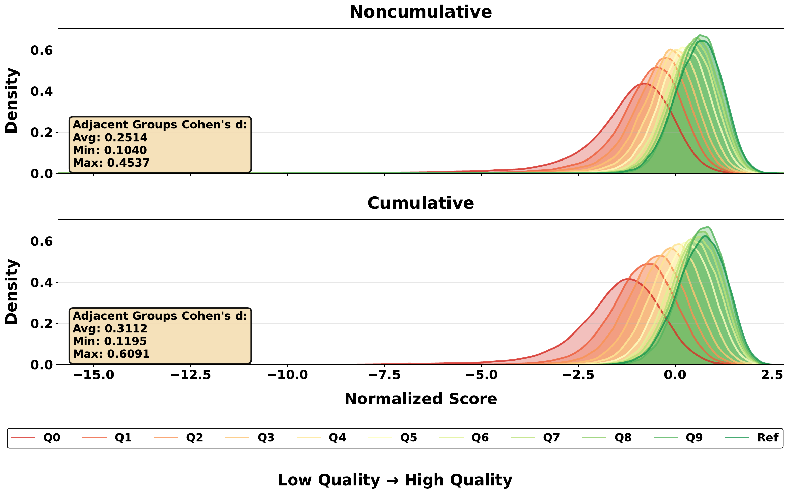
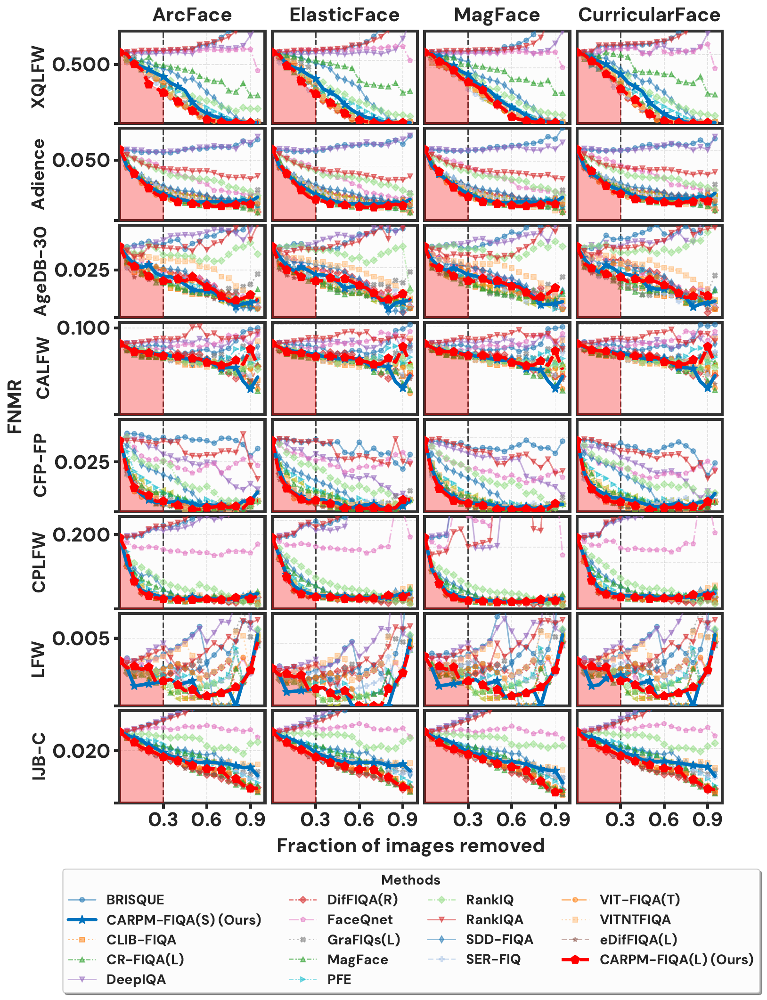

# Learning Steadily: Accumulating Relative Point Margin Scores for Face Image Quality Assessment
# CARPM-FIQA

This repository contains the official implementation of the paper **"[Learning Steadily: Accumulating Relative Point Margin Scores for Face Image Quality Assessment](https://ieeexplore.ieee.org/document/11695208)"**, accepted at IEEE Transactions on Biometrics, Behavior, and Identity Science (T-BIOM).

## Overview

**CARPM-FIQA** (**C**umulative **A**verage of **R**elative **P**oint **M**argin for **FIQA**) is a temporal stabilization strategy for face recognition (FR)-integrated face image quality assessment. FR-integrated FIQA methods such as [CR-FIQA](https://github.com/fdbtrs/CR-FIQA) learn to regress a per-sample relative point margin, the ratio between the similarity of a sample to its own class center (CCS) and to the nearest negative class center (NNCCS). Because the feature space keeps changing during training, this single-epoch target fluctuates and the quality ranking of the training samples is unstable. CARPM-FIQA instead regresses the **cumulative average of the relative point margin over all epochs seen so far**:

$$Q(x)_n = \frac{1}{n}\sum_{j=1}^{n} q_j(x) = \frac{q_n(x) + (n-1)\,Q(x)_{n-1}}{n}, \qquad q_j(x) = \frac{\text{CCS}_j(x)}{\text{NNCCS}_j(x)}$$

The FR model (ArcFace loss) and the quality regression head are trained jointly with $\mathcal{L} = \mathcal{L}_{Arc} + \lambda\,\mathcal{L}_{Q}$ (Smooth L1, $\lambda=10$). At inference, a single forward pass gives the embedding and the quality score.

### Key Features

- **Stable training target**: cumulative averaging reduces the variance and MSE of the quality target and stabilizes sample rankings, with formal guarantees in the paper
- **FR-integrated**: one network gives both the face embedding and the quality score
- **Drop-in change**: on top of CR-FIQA, only the regression target changes, with no extra cost at inference

### Cumulative vs. Non-Cumulative Targets

<p align="center">
  
</p>

AUC-EDC of the training-set quality targets over epochs (ResNet50, CASIA-WebFace). The non-cumulative target degrades after a sweet spot around epoch 20, while the cumulative target keeps improving.

<p align="center">
  
</p>

Normalized quality score distributions of the 11 quality groups of [SynFIQA](https://github.com/oufuzhao/MR-FIQA). The cumulative target separates adjacent quality groups better (average Cohen's d 0.3112 vs. 0.2514).

## Repository Structure

```
├── backbones/iresnet.py              # ResNet50/100 with the quality regression head
├── losses.py                         # ArcFace / CurricularFace headers returning CCS and NNCCS
├── dataset.py                        # CASIA-WebFace (image folders) and MS1MV2 (.rec) loaders
├── train.py                          # CARPM-FIQA training
├── evaluation/
│   ├── get_quality_scores.py         # quality estimation with a trained model
│   ├── edc.py                        # EDC curves (FNMR vs. discard ratio), incl. IJB-C
│   └── auc_table.py                  # AUC-EDC / pAUC-EDC tables
└── scores/                           # released CARPM-FIQA(S)/(L) quality scores of all benchmarks
```

## Installation

```bash
pip install -r requirements.txt
```

The released code was validated with PyTorch 2.7.

## Pretrained Models

Download the pretrained models from [here](https://drive.google.com/drive/folders/1b84SMba_GGSGg9c4UziGtMfArpQSz-qi?usp=drive_link) and place them in the `pretrained/` directory:

| Model | Backbone | Training data | File |
|-------|----------|---------------|------|
| CARPM-FIQA(S) | ResNet50 (`iresnet50`) | CASIA-WebFace | `CARPM-FIQA(S).pth` |
| CARPM-FIQA(L) | ResNet100 (`iresnet100`) | MS1MV2 | `CARPM-FIQA(L).pth` |


## Usage

### 1. Data Preparation

We follow the evaluation data layout of [CR-FIQA](https://github.com/fdbtrs/CR-FIQA). Please obtain the datasets from their official sources and prepare them with the CR-FIQA scripts:

- LFW, AgeDB-30, CFP-FP, CALFW, CPLFW: the `.bin` files of [InsightFace](https://github.com/deepinsight/insightface/tree/master/recognition/_datasets_), extracted with [`feature_extraction/extract_bin.py`](https://github.com/fdbtrs/CR-FIQA/blob/main/feature_extraction/extract_bin.py)
- [XQLFW](https://martlgap.github.io/xqlfw/pages/download.html) (`xqlfw_aligned_112`): [`feature_extraction/extract_xqlfw.py`](https://github.com/fdbtrs/CR-FIQA/blob/main/feature_extraction/extract_xqlfw.py)
- [Adience](https://talhassner.github.io/home/projects/Adience/Adience-data.html): [`feature_extraction/extract_adience.py`](https://github.com/fdbtrs/CR-FIQA/blob/main/feature_extraction/extract_adience.py)
- [IJB-C](https://www.nist.gov/programs-projects/face-challenges): [`IJB-C Evaluation/extract_IJB.py`](https://github.com/fdbtrs/CR-FIQA/blob/main/IJB-C%20Evaluation/extract_IJB.py)

This gives the following layout (all images aligned and cropped to 112x112):

```
data/
└── quality_data/
    └── <dataset>/                    # lfw, agedb_30, cfp_fp, calfw, cplfw, XQLFW, adience, IJBC
        ├── images/
        ├── image_path_list.txt       # quality_data/<dataset>/images/<name>.jpg
        └── pair_list.txt             # <name_a> <name_b> <1: genuine | 0: impostor>
```

### 2. Quality Estimation

```bash
# CARPM-FIQA(L)
python evaluation/get_quality_scores.py --model_path "pretrained/CARPM-FIQA(L).pth" --backbone iresnet100 \
    --data_dir data --datasets lfw,agedb_30,cfp_fp,calfw,cplfw,XQLFW,adience,IJBC --output_dir scores --score_name CARPML
# CARPM-FIQA(S)
python evaluation/get_quality_scores.py --model_path "pretrained/CARPM-FIQA(S).pth" --backbone iresnet50 \
    --data_dir data --datasets lfw,agedb_30,cfp_fp,calfw,cplfw,XQLFW,adience,IJBC --output_dir scores --score_name CARPMS
```

Each line of `scores/<score_name>_<dataset>.txt` is `<image path> <quality score>`, and a higher score means higher quality. The models expect aligned 112x112 images with pixel values normalized to [-1, 1]. Images prepared with the CR-FIQA scripts are used as read by OpenCV (`--color_channel BGR`, the default). For your own images loaded with OpenCV, use `--color_channel RGB`.

### 3. Released Quality Scores

The `scores/` directory contains the quality scores of CARPM-FIQA(S) (`CARPMS_*`) and CARPM-FIQA(L) (`CARPML_*`) used for the results in the paper. It covers Adience, AgeDB-30, CFP-FP, LFW, CALFW, CPLFW, XQLFW and IJB-C (`*_IJBC.txt.gz`, gzip-compressed). The evaluation scripts can use them directly, so you can reproduce the tables without running the models.

### 4. Evaluation (EDC, AUC-EDC, pAUC-EDC)

**FR embeddings.** The evaluation needs embeddings of the officially released [ArcFace](https://github.com/deepinsight/insightface), [ElasticFace](https://github.com/fdbtrs/ElasticFace), [MagFace](https://github.com/IrvingMeng/MagFace), and [CurricularFace](https://github.com/HuangYG123/CurricularFace) models. Extract them with [`feature_extraction/extract_emb.py`](https://github.com/fdbtrs/CR-FIQA/blob/main/feature_extraction/extract_emb.py) of CR-FIQA into `data/quality_embeddings/<dataset>_<FRModel>/<name>.npy` (e.g. `lfw_ArcFaceModel/00000.npy`). For IJB-C, aggregate the image embeddings into template features (`IJBC_<FRModel>/<template_id>.npy`) with `aggregate_templates` in [`IJB-C Evaluation/ijb_qs_pair_file.py`](https://github.com/fdbtrs/CR-FIQA/blob/main/IJB-C%20Evaluation/ijb_qs_pair_file.py). `edc.py` computes the template qualities itself from the image quality scores and the IJB-C meta files (`ijbc_face_tid_mid.txt`, `ijbc_template_pair_label.txt`).

**EDC curves.** The quality of a pair is the minimum quality of its two samples. For IJB-C it is the minimum over all images of both templates. The lowest-quality pairs are discarded first (0% to 95% in 5% steps), and FNMR is measured at FMR = 1e-3 and 1e-4 with thresholds recomputed on the remaining pairs:

```bash
python evaluation/edc.py --data_dir data --embeddings_dir data/quality_embeddings --score_dir scores \
    --ijbc_meta_dir data/IJB_release/IJBC/meta --methods CARPMS,CARPML \
    --datasets adience,agedb_30,cfp_fp,lfw,calfw,cplfw,XQLFW,IJBC \
    --models ArcFaceModel,ElasticFaceModel,MagFaceModel,CurricularFaceModel --output_dir results/fnmrs
```

**AUC-EDC and pAUC-EDC** (discard ratio up to 30%), multiplied by 1000 as in the paper:

```bash
python evaluation/auc_table.py --fnmr_dir results/fnmrs --methods CARPMS,CARPML --output_dir results/aucs
```

`auc_table.py` also adds the *Average* block (mean over FR models) and the *Avg. norm.* column. That column divides each benchmark-FMR column by the best of the evaluated methods, so it matches the paper only when all compared methods are evaluated together (add their score files to `--score_dir` and their names to `--methods`).

Expected pAUC-EDC (x1000, averaged over the four FR models, Table III of the paper):

| Method | FMR | Adience | AgeDB-30 | CFP-FP | LFW | CALFW | CPLFW | XQLFW | IJB-C |
|--------|-----|---------|----------|--------|-----|-------|-------|-------|-------|
| CARPM-FIQA(S) | 1e-3 | 10.6131 | 8.3627 | 4.1878 | 0.5740 | 21.8141 | 21.5416 | 145.3297 | 7.2623 |
| CARPM-FIQA(S) | 1e-4 | 24.4598 | 12.5906 | 6.2847 | 0.8142 | 23.0343 | 39.6972 | 166.4868 | 10.7849 |
| CARPM-FIQA(L) | 1e-3 | 10.3821 | 7.6498 | 3.8887 | 0.7541 | 21.5529 | 20.5959 | 132.2035 | 6.7339 |
| CARPM-FIQA(L) | 1e-4 | 22.2977 | 10.8506 | 6.4677 | 0.9262 | 22.3777 | 48.3652 | 154.9409 | 10.1699 |

Differences in the last decimal can occur across numpy versions, because pairs with equal quality may be discarded in a different order.

<p align="center">
  
</p>

EDC curves at FMR=1e-3 on eight benchmarks with four FR models, comparing CARPM-FIQA with state-of-the-art methods.

### 5. Training

**CARPM-FIQA(S)**: ResNet50 on [CASIA-WebFace](https://github.com/deepinsight/insightface/tree/master/recognition/_datasets_), stored as aligned image folders `<root>/<identity>/<image>.jpg`:

```bash
torchrun --nproc_per_node=4 train.py --dataset webface --data_root data/faces_webface_112x112 --output output/CARPM-FIQA-S
```

**CARPM-FIQA(L)**: ResNet100 on [MS1MV2](https://github.com/deepinsight/insightface/tree/master/recognition/_datasets_) (`train.rec` / `train.idx`, requires `mxnet`):

```bash
torchrun --nproc_per_node=4 train.py --dataset ms1mv2 --data_root data/faces_emore --output output/CARPM-FIQA-L
```

Both use 4 GPUs with 128 images per GPU (global batch 512), SGD (lr 0.1, momentum 0.9, weight decay 5e-4), ArcFace (s=64, m=0.5), and λ=10. The released checkpoints are from iteration 29729 (S) and 170595 (L). A checkpoint (`<step>backbone.pth`) is saved after every epoch, together with `quality_history.npz`, which holds the cumulative relative point margin of every training sample at every epoch.

**Ablations** (Tables I and II of the paper): `--target noncumulative` trains on the single-epoch relative point margin instead of its cumulative average, and `--loss curricularface` replaces ArcFace with CurricularFace. The frozen-backbone variant of Table I is not part of this release.

## Citation

If you use this code, the pretrained models, or the released quality scores, please cite:

```
@ARTICLE{11695208,
  author={Ozgur, Guray and Chettaoui, Tahar and Caldeira, Eduarda and Huber, Marco and Kolf, Jan Niklas and Damer, Naser and Boutros, Fadi},
  journal={IEEE Transactions on Biometrics, Behavior, and Identity Science},
  title={Learning Steadily: Accumulating Relative Point Margin Scores for Face Image Quality Assessment},
  year={2026},
  volume={},
  number={},
  pages={1-1},
  keywords={Modeling;Training;Faces;Biometrics;Computers;Conferences;Ranking (statistics);Computer vision;Quality assessment;Face recognition;Biometrics;face image quality assessment;face recognition;training dynamics},
  doi={10.1109/TBIOM.2026.3734769}}
```

This work builds on CR-FIQA. Please also consider citing it:

```
@InProceedings{Boutros_2023_CVPR,
  author    = {Boutros, Fadi and Fang, Meiling and Klemt, Marcel and Fu, Biying and Damer, Naser},
  title     = {CR-FIQA: Face Image Quality Assessment by Learning Sample Relative Classifiability},
  booktitle = {Proceedings of the IEEE/CVF Conference on Computer Vision and Pattern Recognition (CVPR)},
  year      = {2023},
  pages     = {5836-5845}
}
```

## License

>This project is licensed under the terms of the **Attribution-NonCommercial-ShareAlike 4.0 International (CC BY-NC-SA 4.0)** license.
Copyright (c) 2026 Fraunhofer Institute for Computer Graphics Research IGD Darmstadt
For more details, please take a look at the [LICENSE](./LICENSE) file.
